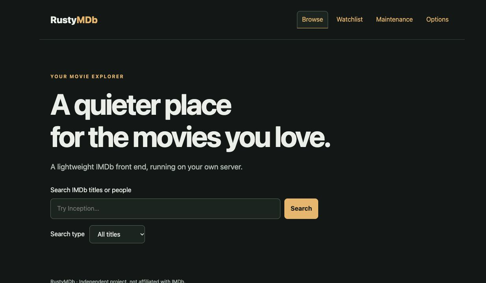
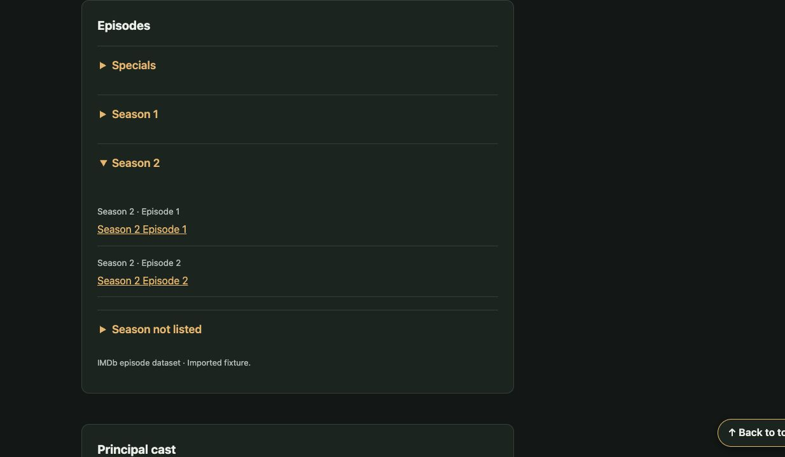

# RustyMDb

A self-hosted movie, TV and people browser for **macOS and Linux**, written in
Rust with Axum, Askama, SQLite, plain CSS and a little JavaScript. No separate
frontend build or database server is required.

IMDb datasets are the primary source. Optional TMDB access adds missing details,
artwork and discovery features. Templates, styles and scripts are embedded in
the executable.

## Features

- Local title and People search with filters, pagination and IMDb ID lookup.
- Movie and TV pages with IMDb ratings, principal cast, directors and writers.
- Collapsible TV seasons with lazily loaded episode lists and pagination.
- Person biographies, profile photos and filmographies with verified local links.
- Optional TMDB storylines, expanded credits, trailers, recommendations and collections.
- Shared watchlist with watched status, notes and filters.
- Maintenance jobs, optional refresh/backup schedules and opt-in backup retention.
- Verified SQLite backups and a helper for preparing restores separately from live data.
- Responsive pages with keyboard-accessible controls and a floating Back to top link.

## Screenshots





The season screenshot uses synthetic demonstration data, not a personal watchlist
or bundled provider artwork.

## Quick start

Install the current stable Rust toolchain and your platform's C compiler/linker
(Xcode Command Line Tools on macOS, or build-essential on Debian/Ubuntu).
Then, from a copy of this repository:

```sh
cargo run --locked
```

Open [http://127.0.0.1:3000](http://127.0.0.1:3000). Stop with Ctrl-C.
Persistent data is stored in `data/rustymdb.sqlite3` by default. SQLite is bundled.
A fresh installation has no datasets; title search can initially use IMDb's
suggestion service, which may be unavailable or blocked by IMDb.

For an optimized build:

```sh
cargo build --release --locked
./target/release/rustymdb
```

## Import IMDb data

These commands download official IMDb datasets and import them transactionally.
Run them one at a time; allow several gigabytes of storage and potentially lengthy
downloads. Failed imports preserve the previous committed dataset.

```sh
cargo run --release --locked -- import-ratings
cargo run --release --locked -- import-titles
cargo run --release --locked -- import-credits
cargo run --release --locked -- import-cast
cargo run --release --locked -- import-episodes
```

Title and People indexes are built during the corresponding imports. Existing
installations can rebuild them with `index-titles` or `index-people`. Import
credits/people before importing cast. Once the server is running, the Maintenance
tab provides the same operations and shows job progress. Only one maintenance job
runs at a time. Avoid separate manual imports while a maintenance job is running.

The datasets are offered for personal and non-commercial use under IMDb's terms:
[IMDb Non-Commercial Datasets](https://data.imdb.com/non-commercial-datasets/).
No datasets, provider images or user databases are distributed in this repository.

## Optional TMDB setup

Open **Options** for step-by-step account/API access instructions. Save either a
TMDB API Read Access Token or v3 API key. The application verifies it before
activation and makes no TMDB requests while unconfigured. Never enter your TMDB
account password into RustyMDb.

Credentials are stored in an owner-only `tmdb-credentials.json` file in the data
directory, separately from SQLite. They are excluded from database-only backups
and are never returned to the browser or included in image URLs. Configure them
again after restoring to another data directory.

IMDb IDs establish title/person matches. Names and release years are never used
to guess a mapping. TMDB coverage can differ from IMDb; each section identifies
its source. Trailers are external links, with no embedded player or autoplay.

## Configuration

| Variable | Default | Meaning |
| --- | --- | --- |
| `RUSTYMDB_BIND` | `127.0.0.1:3000` | Listening address and port |
| `RUSTYMDB_DATA_DIR` | `data` | Persistent data directory |

For example:

```sh
RUSTYMDB_DATA_DIR=/path/to/data RUSTYMDB_BIND=127.0.0.1:3000 ./target/release/rustymdb
```

The application reads environment variables; it does **not** automatically load a
`.env` file. The example systemd service loads its environment file explicitly.

## Deployment and access

**This is a single-household/trusted-network application with no login system.**
Everyone who can reach it shares the watchlist, notes, API configuration and
maintenance controls. Form tokens protect against forged submissions; they do
not provide user authentication. Do not expose an unauthenticated instance to
the public internet. Use a trusted private network or an authenticating reverse
proxy with HTTPS.

For private-network access, bind to an appropriate interface or `0.0.0.0:3000`
and apply your host/network access controls. Keep other applications' ports and
HTTPS routes separate: a Tailscale Serve rule on `/` port 443 can take over an
existing service at the same hostname.

See [Linux service setup](docs/linux-deployment.md) and
[backup, retention and restore](docs/backup-and-restore.md).

## Validation

```sh
cargo fmt --check
cargo test --locked -- --test-threads=1
cargo clippy --locked --all-targets -- -D warnings
cargo build --release --locked
python3 deploy/test-restore.py
```

Tests use generated fixtures and local mock servers; no IMDb download or TMDB key
is required. Single-threaded test execution avoids file-lock inheritance races
when the maintenance tests spawn subprocesses. GitHub Actions is configured to
run these checks on Linux and macOS.

## License and data attribution

The application source is [MIT licensed](LICENSE). That license does not grant
rights to IMDb/TMDB datasets, API content, artwork, trademarks or third-party
libraries. See [third-party notices](THIRD_PARTY_NOTICES.md) and the generated
[dependency license inventory](docs/dependency-licenses.md).

This product uses the TMDB API but is not endorsed or certified by TMDB.
The TMDB logo is used for attribution; RustyMDb is not affiliated with IMDb or TMDB.
